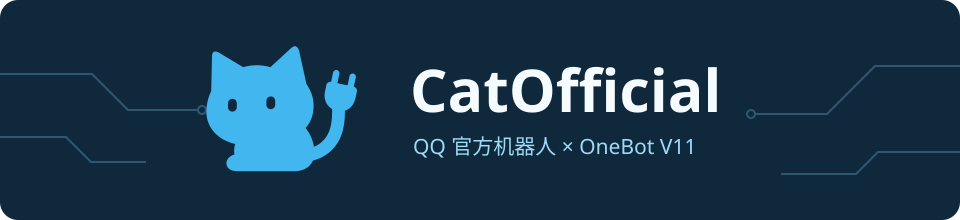

<p align="center">
  
</p>

<p align="center">
  <a href="https://github.com/DiceZone/CatOfficial/releases"></a>
  <a href="https://github.com/DiceZone/CatOfficial/actions/workflows/ci.yml"></a>
  <a href="LICENSE"></a>
</p>

<p align="center">
  <a href="https://github.com/DiceZone/CatOfficial/releases">下载</a> ·
  <a href="#快速开始">快速开始</a> ·
  <a href="#管理面板">管理面板</a> ·
  <a href="#onebot-连接">OneBot 连接</a> ·
  <a href="https://github.com/DiceZone/CatOfficial/issues">问题反馈</a>
</p>

CatOfficial 把 QQ 官方机器人转接为标准 OneBot V11，让原本面向 OneBot 的应用不改代码即可接入官方机器人。

官方机器人已开放的能力会原样中继；官方后续开放新能力，CatOfficial 随之跟进。转接时处理好 OneBot 开发者关心的细节：

- 数字形式的 `user_id` / `group_id`，已做官民绑定的用户与群沿用原 QQ 号与群号
- 历史消息索引：引用回复、`get_msg`、撤回都能用；被动回复所需的 `msg_id` 自动补全（60 分钟内的消息；私聊某人时，没有私聊消息可回也会借用他在群里发的消息，按官方规则须是机器人好友）
- 头像地址、昵称与群身份

## 快速开始

从 [Releases](https://github.com/DiceZone/CatOfficial/releases) 下载对应系统的压缩包（Windows x64 / ARM64、Linux x86_64 / ARM64、macOS Apple 芯片），解压出 `CatOfficial-beta` 文件夹后运行其中的 `catofficial`（Windows 上双击 `catofficial.exe`）：

```
CatOfficial-beta/
├── catofficial(.exe)      启动器：安装已下载的更新后拉起主程序
├── app/                   Windows：主程序 catofficial-core.exe 与全部依赖、运行库
├── catofficial-core       Linux / macOS：主程序
├── web/                   管理面板
├── update-mirrors.json    在线更新的加速镜像列表
├── config.json            首次运行生成
└── data/                  首次运行生成
```

第一次运行会在安装目录生成 `config.json` 并照常启动。打开控制台里显示的管理面板地址（默认 `http://127.0.0.1:18082/`），用控制台里显示的密码登录（也写在 `config.json` 的 `webui.password` 里），按提示改成自己的密码；之后在「登录管理」里添加官方机器人（填 AppID 与 AppSecret，或直接扫码登录），在「连接管理」里添加 OneBot 连接即可。

- 同一套数据（同一个安装目录）只能运行一个进程，重复启动会自动退出。
- 面板端口被占用时自动顺延到下一个空闲端口并写回配置；OneBot 连接的端口被占用时，该连接显示「端口已被其他程序占用」，不会与别的程序抢同一个端口。
- 不要在压缩包里直接运行，也不要把程序放在临时目录里（Windows 上会提示并拒绝启动）。
- 开发时也可以直接运行主程序：`catofficial-core [配置文件]`，此时不支持在线安装更新。

## 启动参数

每一项都可以写在命令行，也可以用环境变量注入（容器、面板托管时更方便）。开关类参数在命令行或环境变量任一处打开即生效（环境变量写 `1` / `true` / `yes` / `on`）；带值的参数以命令行为准。写错的参数会直接报错并列出可用参数。

| 命令行 | 环境变量 | 作用 |
|---|---|---|
| `[配置文件]` | `CATOFFICIAL_CONFIG` | 配置文件路径，默认安装目录的 `config.json`；数据目录固定在它旁边的 `data` |
| `--files-full-access` | `CATOFFICIAL_FILES_FULL_ACCESS` | 文件管理开放整台机器（默认只开放安装目录） |
| `--disable-files` | `CATOFFICIAL_DISABLE_FILES` | 关闭文件管理 |
| `--disable-terminal` | `CATOFFICIAL_DISABLE_TERMINAL` | 关闭网页终端 |
| `--disable-programs` | `CATOFFICIAL_DISABLE_PROGRAMS` | 关闭程序托管 |
| `--max-programs=N` | `CATOFFICIAL_MAX_PROGRAMS` | 最多托管多少个程序（默认 32，`0` 表示不能再添加；已有的照常保留） |
| `--container` | `CATOFFICIAL_CONTAINER` | 容器模式（与 Dice!Next 的 `DICENEXT_CONTAINER` 相同）：在线更新只提示新版本，不下载、不安装 |

关掉的功能不会出现在面板菜单里，接口也会说明是被哪个参数关掉的。面板「重启」与在线更新后的重启会带上同样的参数。另有一个给启动器用的环境变量：`CATOFFICIAL_UPDATE_RESTART=NO`（安装更新后不自动拉起主程序，交给外部的进程守护）。

## 管理面板

| 页面 | 内容 |
|---|---|
| 概览 | 各机器人是否在线、各连接的状态、收发数量，以及服务器的 CPU、内存与磁盘占用 |
| 在线聊天 | 按会话查看消息，以机器人的身份回复文字、图片或 Markdown（Markdown 在弹窗里编辑，右侧实时预览） |
| 登录管理 | 添加多个官方机器人（默认扫码登录，也可手动输入密钥）；接入 OneBot 机器人（如 NapCat，反向或正向 WebSocket），供官民绑定使用 |
| 连接管理 | 添加 OneBot 连接，每个连接单独设置令牌、消息格式、是否上报自身消息、服务哪些官方机器人 |
| 消息记录 / 运行日志 | 收发的消息，可搜索、按时间范围、类型、会话或发送者筛选，可调每页条数与排序；程序最近 3000 条日志 |
| 自定义回复 | 关键词触发的自动回复，见下文 |
| 官方图床 | 官方素材接口里的图片：上传、替换、删除，复制可写进 Markdown 的引用 |
| 官民绑定 | 已绑定的用户与群、等待确认的群、手动绑定与解绑 |
| 文件管理 | 浏览、上传、下载、在线编辑、图片预览、压缩解压（可选 GBK 文件名）、剪切复制粘贴；回收站与操作记录，见下文 |
| 网页终端 | 在这台机器上打开命令行，可同时开多个，关掉网页也不中断 |
| 程序托管 | 托管别的程序（另一个骰子、NapCat、脚本……）：启停、看控制台、输入指令、随 CatOfficial 启动、退出后自动重启 |
| 设置 | 主人、邮件（SMTP）与运行异常通知、绑定指令、Webhook 入口、面板端口与密码、Windows 托盘、聊天记录与图片缓存的保留天数 |

- 机器人、连接与设置的修改写入配置文件并立即生效，不用重启。只有面板自身的地址与官方 Webhook 入口改了要重启，面板顶部会提示，点一下即可；重启后登录状态保留。
- 面板与 OneBot 使用不同端口。默认只监听本机；改成 `0.0.0.0` 时其他机器也能访问，请使用足够强的密码。同一 IP 连续输错 5 次密码会被暂停 5 分钟。
- 前端文件放在程序旁的 `web` 目录（`webui.root` 可改）。从源码构建：`cd webui && npm install && npm run build`，再把 `webui/dist` 复制为 `web`。

## OneBot 连接

四类连接与 NapCat 的划分一致：

| 类型 | 说明 |
|---|---|
| `http_server` | HTTP API：`POST /{action}`，参数可放 JSON 请求体、表单或查询串 |
| `ws_server` | 正向 WebSocket：`/` 收事件并调用动作；`/event` 只收事件；`/api` 只调用动作 |
| `http_client` | HTTP POST 上报；设了令牌时带 `X-Signature: sha1=…`；响应体可做快速回复（`reply`、`auto_escape`、`at_sender`） |
| `ws_client` | 反向 WebSocket（Universal）：每个机器人一条连接，带 `X-Self-ID`；断线按 `reconnect_interval` 重连 |

鉴权用 `Authorization: Bearer <令牌>`，或查询参数 `access_token`。

反向 WebSocket、HTTP POST 上报与原 QQ 机器人的地址可以是 `wss://` / `https://`。`http_server` 与 `ws_server` 本身不带 TLS，需要让外网应用以 `wss://` 接入时，请在前面放 Nginx、Caddy 等反向代理。一个连接服务多个官方机器人时，事件带各自的 `self_id`；调用动作时用参数 `self_id`（或请求头 `X-Self-ID`）指定机器人，不指定则用第一个。开启「上报自身消息」后，机器人发出的消息以 `message_sent` 事件上报。

配置文件里的写法：

```jsonc
{
  "bots": [
    { "id": "bot1", "name": "主号", "enabled": true, "type": "official", "app_id": "", "app_secret": "",
      "mode": "websocket", "subscribe_group_member_events": false, "auto_ack_interactions": true },
    { "id": "bot2", "name": "", "enabled": true, "type": "onebot", "connection": "reverse", "host": "127.0.0.1", "port": 6800, "token": "" }
  ],
  "connections": [
    { "id": "ws", "name": "正向 WebSocket", "enabled": true, "type": "ws_server", "host": "127.0.0.1", "port": 6700,
      "token": "", "message_format": "array", "report_self": false, "heartbeat_interval": 30000, "bots": [] }
  ],
  "masters": [ { "bot_id": "bot1", "openid": "…" } ],
  "notify_masters": true,
  "webhook": { "path": "/webhook/qqbot", "standalone": false, "host": "0.0.0.0", "port": 8443 },
  "smtp": { "enabled": false, "host": "", "port": 465, "security": "ssl", "username": "", "password": "", "from": "", "notify_emails": [], "notify_errors": true },
  "bind": { "enabled": true, "command": ".bind", "window_seconds": 5, "group_confirm_users": 3, "email_enabled": true, "code_ttl_minutes": 10 },
  "webui": { "enabled": true, "host": "127.0.0.1", "port": 18082, "password": "", "root": "web" },
  "log_level": "info", "message_retention_days": 365, "image_cache_days": 7
}
```

机器人的 `name` 留空时显示机器人昵称。OneBot 机器人的 `connection` 为 `reverse`（默认，在 NapCat 里添加 WebSocket 客户端连 `ws://host:port/`）或 `forward`（填 `url`，CatOfficial 去连它）。连接的 `bots` 为空表示服务全部官方机器人。Webhook 入口默认挂在面板端口上，`standalone` 为 true 时单独监听 `port`。旧版的单机器人配置（`bot` + `onebot`）启动时会自动转成上面的格式。

数据固定放在配置文件旁的 `data` 目录：数据库 `catofficial.db`、自定义回复 `replies.json`、图片缓存 `cache/images`。聊天记录默认保留 365 天，图片缓存默认保留 7 天（官方给的图片地址会过期，面板显示缓存下来的副本），`0` 表示不删除聊天记录、不缓存图片。主人的 `bot_id` 必须填：同一个用户在不同官方机器人下的 OpenID 各不相同。

## 自定义回复

收到的消息命中规则时，由 CatOfficial 直接回复，默认不再上报给 OneBot 应用（每条规则可改）。写法与 Dice!Next 的自定义回复相同：

- 条件：完全匹配、包含、前缀、正则，多个条件可选「全部满足」或「任一满足」；
- 回复：可写多条，按权重随机选一条；纯文本或 Markdown；
- 限制：触发概率、冷却时间（群里按群算，私聊按人算）、只在群聊或私聊、只对哪些机器人生效；优先级数字越大越先匹配。

回复里可以用 `{变量}`，面板编辑回复时点一下即可插入，例如 `{version}`、`{platform}`、`{uptime}`（x天x小时x分钟）、`{cpu}`、`{memory}`、`{bot_name}`、`{bots_online}`、`{sender}`、`{group}`、`{message}`、`{date}`、`{time}`；`{a|b|c}` 随机选一项，正则匹配时 `{$1}` 是第一个捕获组。

自带一条「CatOfficial 状态」，发送 `#catofficial` 或 `#co` 时回复：

```
CatOfficial 状态
版本：{version}
平台：{platform}
运行时长：{uptime}
```

它可以修改、停用，或在面板里恢复默认，但不能删除。规则存在 `data/replies.json`。

## 号码与官民绑定

官方只提供 OpenID。CatOfficial 给每个 OpenID 分配一个固定号码：群为 `1` 开头、用户为 `2` 开头的 13 位数字，与 Dice!Next 相同。号码一经分配就不会再给别人，绑定或解绑后空出来的号码也不会回收。`self_id` 是机器人的真实 QQ 号。

用户或群从普通 QQ 机器人迁移过来时，绑定回原来的 QQ 号与群号，应用里按号码存的数据就能接上。绑定只是 CatOfficial 里的号码映射，不搬迁任何数据。

群友可以自助绑定（指令可在设置中修改）：

```
.bind <暗号>        // 在官方机器人与原 QQ 机器人都在的群里发送，两边几秒内同时收到即完成绑定
.bind email <QQ号>  // 把验证码发到 <QQ号>@qq.com（需要配置 SMTP），以此确认真实 QQ 号
.bind code <验证码> // 用邮件里的验证码完成绑定
.bind status        // 查看当前绑定
.bind remove        // 解除自己的绑定
.bind group <群号>  // （主人）把本群直接关联到群号
```

暗号绑定需要在「登录管理」里接入一个 OneBot 机器人（如 NapCat），并和官方机器人在同一个群。用户绑定立即生效；群号在群主或管理员完成绑定时立即关联，否则需要凑够设定人数的普通成员。同一暗号被两个人同时使用时会作废，请用不容易撞的暗号。

主人也可以在面板的「官民绑定」页手动绑定，或：

- 在 `data` 目录下放 `bindings.json`，启动时载入：
  ```json
  [ { "type": "user", "openid": "…", "qq": 12345678 },
    { "type": "group", "openid": "…", "qq": 87654321 } ]
  ```
- 调用扩展动作 `set_identity_binding`：`{"type": "user", "user_id": <当前号码>, "qq": <真实号码>}`。

## 主人与运行异常通知

主人 = 某个官方机器人（或全部）上的 OpenID，可以在群里用 `.bind group <群号>` 直接关联群号。OpenID 可以让对方发送 `.bind status` 查看。

程序出现错误时，CatOfficial 会把一段时间内的错误汇总（最多每 10 分钟一次），发到设置里的通知邮箱（可填多个），并私聊通知主人。邮件也用于 `.bind email` 的验证码。

## 支持的动作

| 动作 | 说明 |
|---|---|
| `send_private_msg` / `send_group_msg` / `send_msg` | 文字、@、引用、图片、语音、视频、文件；图片可用 URL、`base64://`、本地路径 |
| `delete_msg` | 撤回机器人发出的消息 |
| `get_msg` | 取回收发过的消息；引用 CatOfficial 没见过的旧消息时，按官方带来的内容补建索引 |
| `get_login_info` / `get_stranger_info` / `get_friend_list` | 好友列表为私聊过的用户 |
| `get_group_info` / `get_group_list` / `get_group_member_info` / `get_group_member_list` | 来自收到过的消息与事件 |
| `set_group_kick` / `set_group_ban` / `set_group_add_request` | 需要机器人有对应的官方群管权限 |
| `get_status` / `get_version_info` / `can_send_image` / `can_send_record` | |

官方没有对应能力的动作返回 `retcode` 1404。扩展动作：

| 动作 | 说明 |
|---|---|
| `set_identity_binding` | 官民绑定，见上文 |
| `get_official_id` | 查号码对应的 OpenID |
| `call_official_api` | 直接调用开放平台接口：`{"method": "GET", "path": "/v2/…", "body": {}}` |

扩展消息段：`markdown`（`{"content": "…"}` 或模板参数）、`keyboard`（按钮）。收到的事件里，用户与发送者带 `avatar` 字段；也可以请求 `/avatar/user/{user_id}?s=640` 跳转到头像。

## 事件

| 官方事件 | OneBot 事件 |
|---|---|
| 单聊、群聊（@ 或全量）、频道 @ 消息 | `message`；群里 @ 机器人时消息开头带 `[CQ:at,qq=<self_id>]` |
| 机器人入群 / 被移出 | `notice.group_increase`（invite）/ `notice.group_decrease`（kick_me） |
| 成员入群 / 退群 | `notice.group_increase`（approve）/ `notice.group_decrease`（leave） |
| 添加好友 | `notice.friend_add` |
| 加群申请 | `request.group`（add） |
| 其他（主动消息开关、按钮互动、订阅状态、频道事件等） | `notice.qq_official`，`sub_type` 为官方事件名的小写，原始数据在 `data` |

## Windows 托盘

在 Windows 上，程序启动后最小化到右下角托盘（第一次启动除外，控制台要显示生成的面板密码），控制台的关闭按钮会被禁用，避免误关。右键托盘图标：

- 打开应用目录
- 显示 / 隐藏控制台
- 打开网页面板
- 开机自启动（勾选即写入当前用户的启动项）
- 退出

托盘的悬停提示文字与是否最小化到托盘可在面板「设置 → Windows 托盘」修改，也可以直接编辑配置文件的 `tray` 段：

```json
"tray": { "text": "", "start_hidden": true }
```

## 文件管理、网页终端与程序托管

这三页可以直接操作运行 CatOfficial 的机器。面板监听的不是本机时，页面顶部会提示风险；请使用足够强的面板密码。

- **文件管理**默认只开放 CatOfficial 的安装目录，越不出去（符号链接、目录联接也算）。启动时加参数 `--files-full-access`（或环境变量 `CATOFFICIAL_FILES_FULL_ACCESS=1`）才开放整台机器，Windows 上根目录列出各个盘。删除的文件先进回收站，保留 7 天；覆盖时被盖掉的那一份也进回收站。每次改动都记录时间、IP、操作与路径。回收站与记录放在安装目录的 `.catofficial` 里，文件管理中看不见。
- **网页终端**在 Windows 上打开 PowerShell（需要 Windows 10 1809 或更新），在 Linux / macOS 上打开 `$SHELL`，工作目录是安装目录。终端一直跑在这台机器上，关掉网页后回来还能接着看；两小时没人看会自动关闭。
- **程序托管**的每个实例有自己的目录，默认在 `data/instances/<实例目录>/`（方便管理与搬迁），留空按实例名称自动创建；只能填 `data/instances` 下的文件夹名称，用 `--files-full-access` 启动时才能填安装目录以外的绝对路径。启动命令在实例目录里运行，程序就在实例目录里时直接写文件名即可。
  - **导入压缩包**（.zip / .tar.gz）：解到实例目录，原来的目录整个移进回收站；压缩包外面只套了一层文件夹时自动去掉。导入前需先停止程序。
  - **日志**：控制台输出同时按天写进 `data/instance-logs/<实例>/`，崩溃或重启 CatOfficial 之后控制台会先显示上次的结尾，历史日志可以在面板里下载。保存天数与每个实例的上限在「日志设置」里改（默认 30 天、100 MB），超出的从最旧的删起。
  - 停止时先输入设置的停止指令（如 `stop`，留空则发送 Ctrl+C），超时后强制结束；两分钟内连续退出五次就不再自动重启。CatOfficial 退出时会先停止所有托管的程序。删除实例时可以选择把实例目录与日志一起移进回收站。设置保存在 `data/programs.json`。

## 在线更新

面板「关于」里可以检查新版本、下载并安装，也可以设置自动检查间隔与发现新版本后的动作（仅通知 / 自动下载 / 自动安装并重启，可指定每天的安装时间）。流程与 [Dice!Next](https://github.com/DiceZone/Dice-Next) 相同：

1. 从 GitHub Release 读取 `update-manifest.json`，同时试 GitHub 直连与 `update-mirrors.json` 里的加速镜像，用最先成功的来源；
2. 下载本平台的安装包，核对大小与 SHA-256；
3. 解压到 `updates/pending`；
4. 安装时主程序退出，由启动器替换程序文件（旧文件保留在 `updates/rollbacks`，失败自动回滚）后拉起新版本。

`config.json` 与 `data` 不在安装包里，更新不会碰到。检测到在容器里运行时只提示新版本，请更新镜像后重建容器。Linux / macOS 用 systemd 或 launchd 守护时，请让它运行 `catofficial`（管理程序）而不是 `catofficial-core`。

## 构建

需要 CMake 3.21+、C++20，以及 [Drogon](https://github.com/drogonframework/drogon)、[IXWebSocket](https://github.com/machinezone/IXWebSocket)、[nlohmann/json](https://github.com/nlohmann/json)、OpenSSL、SQLite3、libcurl（`vcpkg.json` 已列出）。

Android 应用（WebView 包现有面板，核心在前台服务里跑，程序托管走 POSIX 伪终端）见 [`android/README.md`](android/README.md)，一键准备原生库与前端：`scripts/build-android.ps1`。

```
cmake -B build -S . -DCMAKE_TOOLCHAIN_FILE=<vcpkg>/scripts/buildsystems/vcpkg.cmake
cmake --build build --config Release
```

产物为启动器 `catofficial`、主程序 `catofficial-core` 与单元测试 `catofficial-tests`。`-DCATOFFICIAL_BUILD=N` 可指定构建号，版本显示为 `0.1.0-beta.N`。

推送到 `main` 时 GitHub Actions 会自动编译前后端并运行测试（`.github/workflows/ci.yml`）；在 Actions 页面手动运行「Release CatOfficial」会编译全部平台的安装包并发布 Release（`.github/workflows/release.yml`）。本地打包可用 `scripts/package-windows.ps1` 与 `scripts/package-unix.sh`。

## 作为库使用

协议层全部是头文件（`catofficial::core`），[Dice!Next](https://github.com/DiceZone/Dice-Next) 的 QQ 官方机器人适配器即基于它构建。作为子项目引用时默认只提供协议层，不编译程序与测试。

```cmake
add_subdirectory(path/to/CatOfficial)
target_link_libraries(your-target PRIVATE catofficial::core)
```

| 头文件 | 内容 |
|---|---|
| `catofficial/bot.h` | 一个机器人的完整生命周期，发送时自动补全被动回复 |
| `catofficial/qrlogin.h` | 扫码登录官方机器人，取回 AppID 与 AppSecret |
| `catofficial/session.h` | AccessToken、WebSocket 连接、鉴权、心跳与重连 |
| `catofficial/event.h` | 与框架无关的事件解析 |
| `catofficial/api.h` | 开放平台接口调用、机器人资料与分享链接 |
| `catofficial/media.h` | 富媒体 URL 直传与本地文件分片上传 |
| `catofficial/webhook.h` | Webhook 验签、回调地址验证与按 AppID 分派 |
| `catofficial/reply_state.h` | 被动回复序号与事件去重 |
| `catofficial/protocol.h` | 字段解析、WebSocket 订阅的 intents |
| `catofficial/message.h` | 官方消息格式（表情、图片地址等） |

## 许可

[AGPL-3.0](LICENSE)。通过 OneBot 协议连接 CatOfficial 的应用不受此许可约束；修改 CatOfficial 本身或将其代码并入其他程序时，须以相同许可公开源代码，以网络服务形式提供修改版时亦然。

「CatOfficial」名称与标志未经许可不得用于衍生版本。
